<div align="center">


# Salaty Reminder

**Prayer times that live in your Windows taskbar.**

A small, native widget that sits next to the clock, counts down to the next prayer,
reminds you before it, plays the adhan, and speaks both English and Arabic.

[](https://github.com/medovanx/salaty-reminder/releases/latest)
[](https://github.com/medovanx/salaty-reminder/actions/workflows/ci.yml)
[](https://github.com/medovanx/salaty-reminder/releases)
[](LICENSE)


[**Download**](https://github.com/medovanx/salaty-reminder/releases/latest) | [Features](#features) | [Screenshots](#screenshots) | [Build](#build-from-source) | [العربية](#بالعربية)


</div>

---

## Features

- **Lives in the taskbar.** Embedded right next to the notification area, like the weather widget. It hides with the taskbar in fullscreen apps, survives Explorer restarts and steps aside for other taskbar tools such as TrafficMonitor.
- **Next prayer at a glance.** Name, time and a live countdown. Friday's Dhuhr shows as Jumu'ah.
- **Prayer card.** Click the widget for all six times with an icon for each in the colours of the sky, a progress bar from the last prayer to the next, the Gregorian and Hijri dates, and the sunnah rawatib for each prayer.
- **Any day, not just today.** Step through days with the arrows, mouse wheel or arrow keys, or open the calendar (with Hijri days under each date) and jump anywhere: click its title to pick a month or a year directly.
- **Reminders.** A notification at prayer time, an early heads-up a few minutes before, a flashing widget, and an optional adhan (a built-in recording or your own MP3/WAV/OGG file).
- **Automatic location.** Uses Windows location, falls back to your IP address, or pick any city by name.
- **Accurate times.** Astronomical calculation with nine methods (Egyptian General Authority, Muslim World League, Umm al-Qura, ISNA, Karachi, Kuwait, Qatar, Dubai, Diyanet), Shafi'i or Hanafi Asr, and correct daylight saving changes.
- **English and Arabic.** Full right-to-left layout in Arabic; switch from Settings or the widget's right-click menu.
- **Auto-updates.** Checks GitHub Releases, verifies the download's SHA-256 and updates itself in place, with progress shown in Settings and on the widget. It never restarts during the adhan or near a prayer.
- **Light and native.** One small Windows app, no Electron, no ads, no account.

## Screenshots

<table>
  <tr>
    <td align="center">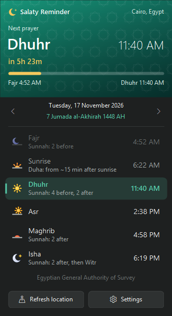<br><sub>Prayer card</sub></td>
    <td align="center">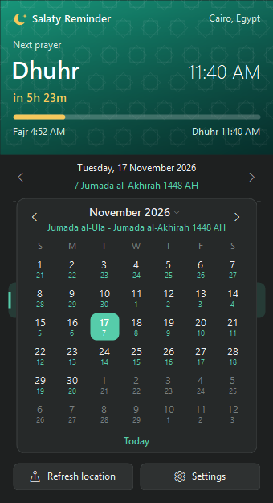<br><sub>Calendar with Hijri dates</sub></td>
    <td align="center">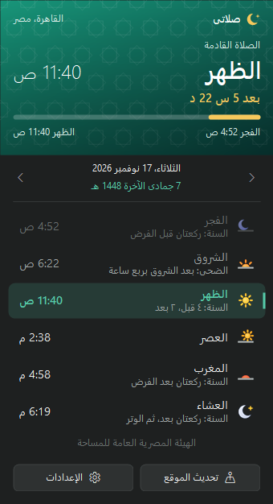<br><sub>Arabic, right to left</sub></td>
  </tr>
  <tr>
    <td align="center">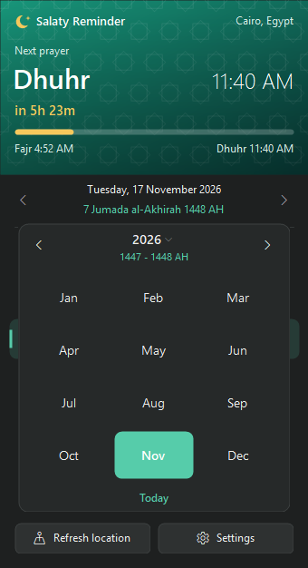<br><sub>Click the title to pick a month</sub></td>
    <td align="center">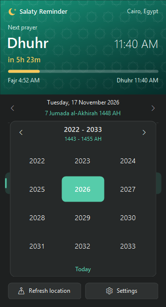<br><sub>Click again to pick a year</sub></td>
    <td align="center">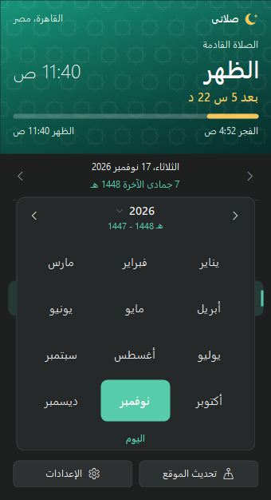<br><sub>Months in Arabic</sub></td>
  </tr>
</table>

<table>
  <tr>
    <td align="center">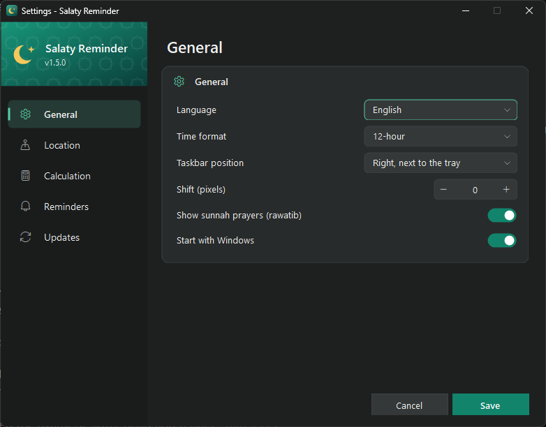<br><sub>Settings</sub></td>
    <td align="center">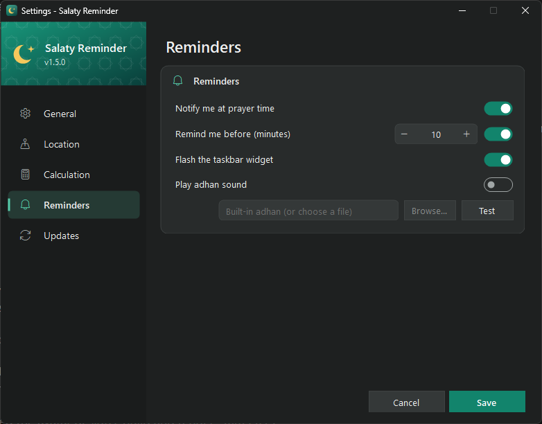<br><sub>Reminders</sub></td>
  </tr>
  <tr>
    <td align="center">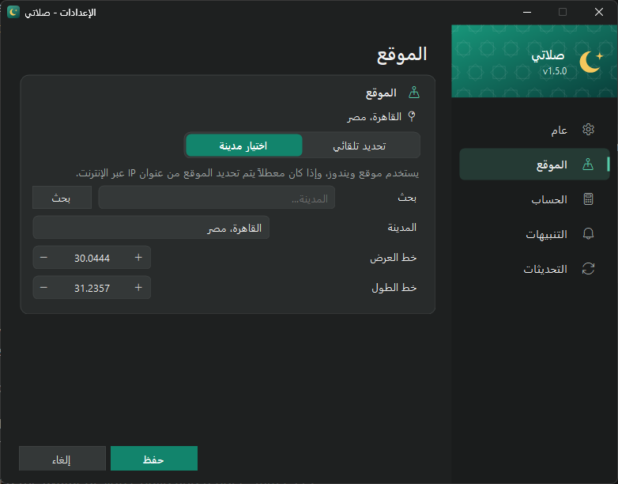<br><sub>Location (Arabic)</sub></td>
    <td align="center">
      <br><sub>At prayer time the widget flashes</sub><br><br>
      <br><sub>Arabic widget</sub>
    </td>
  </tr>
  <tr>
    <td align="center">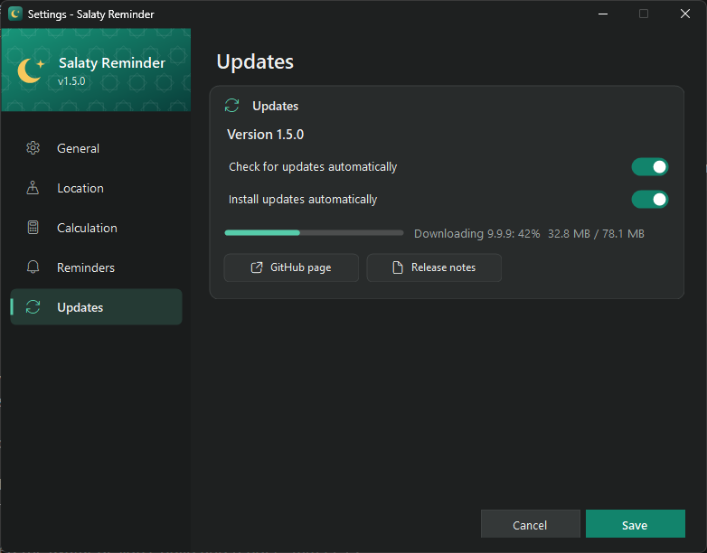<br><sub>Updates, with download progress</sub></td>
    <td align="center">
      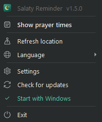<br><sub>Right-click menu</sub><br><br>
      <br><sub>The widget shows update progress too</sub>
    </td>
  </tr>
</table>

## Install

1. Download **`SalatyReminder.exe`** from the [latest release](https://github.com/medovanx/salaty-reminder/releases/latest).
2. Put it somewhere permanent, for example `%LOCALAPPDATA%\Programs\Salaty Reminder\`, and run it.
3. Right-click the widget and turn on **Start with Windows**.

The exe is self-contained, so you don't need to install .NET. Windows SmartScreen may warn on first run because the exe isn't code-signed yet: choose **More info**, then **Run anyway**.

## Usage

| Action | What happens |
| --- | --- |
| Click the widget | Opens the prayer card (stops the adhan and flashing if active) |
| Right-click the widget | Menu: times, refresh location, settings, check for updates, start with Windows, exit |
| `<` and `>` in the card, mouse wheel, arrow keys | Previous or next day |
| Click the date in the card | Calendar to jump to any day; click its month title to pick a month, then again to pick a year |
| `Home` / `Esc` | Back to today / close the card |
| Launch the exe again | Opens the card of the running instance |

## Settings

| Page | Options |
| --- | --- |
| General | Language (English, Arabic), 12 or 24 hour clock, widget position (beside the tray or on the left) and shift in pixels, show sunnah prayers, start with Windows |
| Location | Detect automatically, or search for a city; latitude and longitude can be edited |
| Calculation | Method, Asr (Standard or Hanafi), Hijri date adjustment of up to 2 days |
| Reminders | Notification at prayer time, early reminder and its minutes, flash the widget, play the adhan and pick its file |
| Updates | Check automatically, install automatically, check now |

Settings are stored in `%APPDATA%\SalatyReminder\settings.json`. There is no tray icon: notifications are Windows toasts, and the app registers its name and icon for them under `HKCU\Software\Classes\AppUserModelId\medovanx.SalatyReminder`.

## Privacy

Salaty Reminder has no account, analytics or tracking. It only goes online for these services, all used without an API key:

| Service | When | What it sends |
| --- | --- | --- |
| [BigDataCloud](https://www.bigdatacloud.com/) | Auto location, to name the city | Your coordinates |
| [ipwho.is](https://ipwho.is/) | Auto location, only if Windows location is off | Your IP address (implicitly) |
| [Open-Meteo Geocoding](https://open-meteo.com/en/docs/geocoding-api) | When you search for a city | The search text |
| [GitHub API](https://docs.github.com/rest/releases) | Update checks | Nothing besides the request |

Choose a city manually and turn off update checks for a fully offline app. Prayer times are always calculated on your PC.

## How it works

- **The widget** is a per-pixel-alpha child window inside `Shell_TrayWnd`, the same technique TrafficMonitor uses. It places itself left of the notification area and of any other app's window there, and recreates itself when Explorer restarts (`TaskbarCreated`). When Windows reports the tray area wrongly after boot, it finds the real edge through UI Automation. On Windows 10 it shrinks the task-button strip to make room.
- **Prayer times** use the well-known [PrayTimes.org](http://praytimes.org/) astronomical algorithm, computed in UTC and converted with your time zone's rules for each date. Results match [Aladhan](https://aladhan.com/) to the minute for Cairo in winter and across Egypt's daylight saving change.
- **Updates** come from GitHub Releases tagged `vMAJOR.MINOR.PATCH`. The new exe is downloaded next to the running one and checked against the SHA-256 digest GitHub publishes. The running exe is then renamed to `.old`, the new one takes its place and restarts.

## Project structure

```text
salaty-reminder/
├── src/
│   ├── SalatyReminder.Core/        Prayer-time maths, no Windows or UI dependencies
│   │   └── Prayers/                PrayerCalc, calculation methods, day times
│   └── SalatyReminder/             The Windows app
│       ├── Assets/                 Icon and built-in adhan
│       ├── Configuration/          Settings and start-with-Windows
│       ├── DevTools/               --selftest, --shots and --render-icon
│       ├── Interop/                Win32 and DWM calls
│       ├── Localization/           English and Arabic text and formatting
│       ├── Services/               Location, updater, error log
│       └── UI/
│           ├── Card/               The prayer-times popup
│           ├── Controls/           Themed toggle, dropdown, number box, calendar...
│           ├── Settings/           The settings window
│           ├── Styling/            Theme colours and drawing helpers
│           └── Taskbar/            The widget inside the taskbar
├── tests/
│   └── SalatyReminder.Core.Tests/  xUnit tests against Aladhan reference times
├── docs/                           README images
├── Directory.Build.props           Version and settings shared by every project
├── global.json                     Pinned .NET SDK
└── SalatyReminder.slnx
```

## Build from source

Requirements: Windows 10 or 11 and the [.NET 10 SDK](https://dotnet.microsoft.com/download).

```bash
git clone https://github.com/medovanx/salaty-reminder.git
cd salaty-reminder
dotnet build
dotnet test
dotnet run --project src/SalatyReminder -c Release
```

Build the single-file release exe:

```bash
dotnet publish src/SalatyReminder/SalatyReminder.csproj -c Release -r win-x64 --self-contained -p:PublishSingleFile=true -p:IncludeNativeLibrariesForSelfExtract=true -p:EnableCompressionInSingleFile=true -o publish
```

Developer switches:

| Switch | Purpose |
| --- | --- |
| `--selftest out.txt LAT LON yyyy-MM-dd [method] [hanafi] [timezone]` | Write computed times to a file |
| `--shots DIR` | Render the card, calendar, settings and widget to PNGs (uses Cairo, not your location) |
| `--render-icon DIR` | Regenerate `app.ico` and a 512 px PNG |
| `--test-toast` | Start normally and show a sample prayer notification |

## Releasing

Versions follow [Semantic Versioning](https://semver.org/). Bump `<Version>` in `Directory.Build.props`, add the changes to [CHANGELOG.md](CHANGELOG.md), then tag and push:

```bash
git tag v1.1.0
git push origin v1.1.0
```

The [release workflow](.github/workflows/release.yml) runs the tests, builds the exe and publishes a GitHub Release, which running copies pick up automatically.

## Credits

- Built-in adhan: "Call to prayer from the Prophet's Mosque" by **ejaz215** ([Freesound](https://freesound.org/people/ejaz215/sounds/33937/)), via [Wikimedia Commons](https://commons.wikimedia.org/wiki/File:33937_ejaz215_call-to-prayer-from-the-prophet-s-mo.ogg), licensed [CC BY 3.0](https://creativecommons.org/licenses/by/3.0/).
- Prayer time algorithm: [PrayTimes.org](http://praytimes.org/) by Hamid Zarrabi-Zadeh.
- Icons: Segoe Fluent Icons by Microsoft, built into Windows.

## License

[MIT](LICENSE). The bundled adhan recording is CC BY 3.0, as credited above.

---

<div dir="rtl">

## بالعربية

**صلاتي** أداة صغيرة تظهر في شريط المهام بجوار الساعة، تعرض الصلاة القادمة والوقت المتبقي لها، وتنبهك قبلها وعند دخول وقتها، ويمكنها تشغيل الأذان.

- تحديد الموقع تلقائيًا أو اختيار المدينة يدويًا
- تسع طرق حساب، منها الهيئة المصرية العامة للمساحة وأم القرى ورابطة العالم الإسلامي
- بطاقة تعرض مواقيت اليوم كاملة مع السنن الرواتب والتاريخين الميلادي والهجري
- تصفح أي يوم بالأسهم أو من التقويم
- واجهة عربية كاملة من اليمين إلى اليسار
- تحديث تلقائي آمن من GitHub

**التثبيت:** حمّل `SalatyReminder.exe` من [آخر إصدار](https://github.com/medovanx/salaty-reminder/releases/latest) وشغّله، ثم فعّل "التشغيل مع ويندوز" من قائمة الزر الأيمن على الأداة.

</div>
